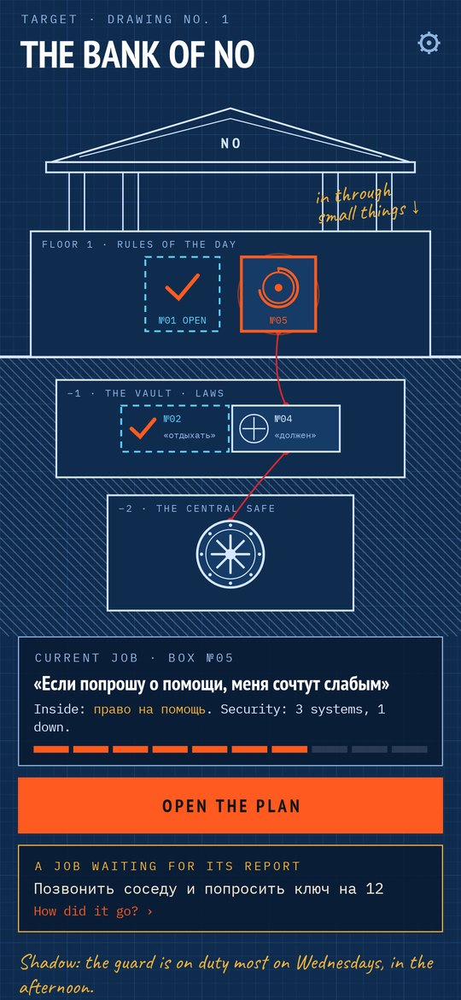
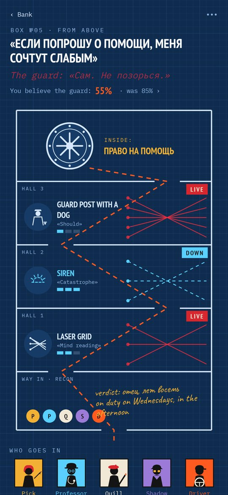
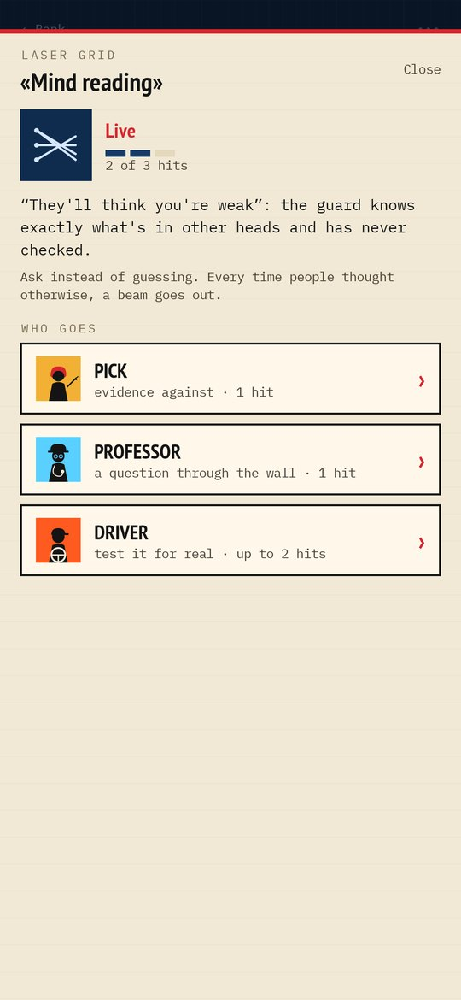
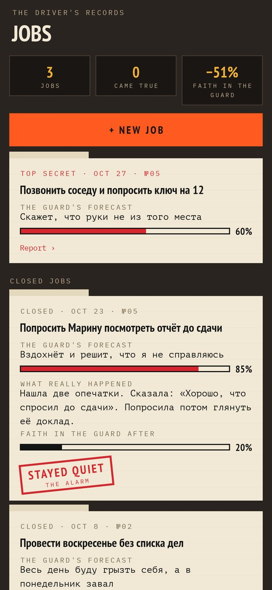
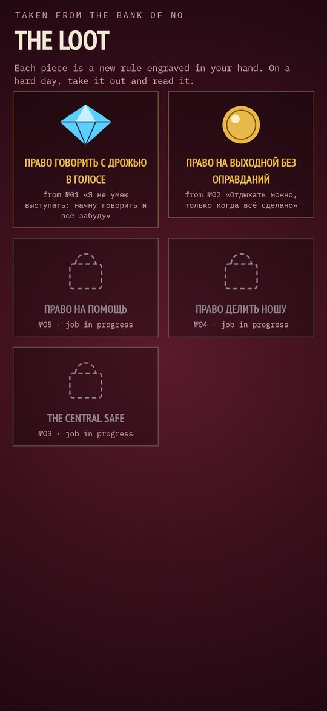

# Inside Job

### Crack the bank where your beliefs keep what you forbade yourself

*For years you've been depositing in the Bank of No everything you forbade yourself: asking for help, resting, making mistakes, saying no. Each limiting belief is a guarded box, and the guard speaks in your own voice. Put a crew together, case the place, take the security down one system at a time, and walk out with what's yours. A heist game built on cognitive behavioural therapy. Free, no ads, no account, no internet.*

**English** · [Русский](README.ru.md) · [Changelog](CHANGELOG.md)

    

**[Download the APK](https://github.com/bigdevwhale/insidejob/releases/latest/download/InsideJob.apk)** · Android 9+

---

## How it works

1. **The bank in cross-section.** Floor 1 keeps the rules of the day ("If I ask for help, they'll think I'm weak"), the vault below keeps the laws ("I must cope with everything alone"), the central safe the core beliefs ("I'm not good enough"). Red string shows what rests on what: open a box below, and the alarms above lose power.
2. **Each box has a guard and a prize.** The guard's line in its own words, and inside, the right the belief took: the right to help, to rest, to a late start. 192 ready boxes in 8 spheres, or your own.
3. **Security systems are tricks of thought.** Mind reading is a laser grid, catastrophising a siren, "should" a guard post with a dog, all-or-nothing a binary lock: 14 systems, each needing three hits.
4. **The crew.** The Pick files evidence against (1 hit). The Professor taps a Socratic question through the wall, and your answer clicks the mechanism (1 hit; 304 questions). The Driver takes you on a job, a behavioural experiment: the guard's forecast and how sure it is before, what really happened after, and a stamp (up to 2 hits; 224 ready jobs). The Shadow logs when the guard is on duty. The Quill rewrites the old verdict and engraves the new rule. Each levels up with use.
5. **Recon first.** Who passed the verdict and when, and at least one sighting of the guard, before the safe can be opened.
6. **Cracking the safe.** The dial spins, the door swings, the loot goes into the velvet case with your new rule engraved on it. If the guard comes back, the box locks again, but part of the old work holds.
7. **Evening round.** One quiet reminder, only on days with nothing logged. Crisis words open a page of helplines instead.

Not a treatment and not a substitute for a therapist.

## Under the hood

- Kotlin, Jetpack Compose, Room, DataStore, WorkManager. Everything stays on the phone.
- The bank, the plans, the crew and the loot are drawn in code (`ui/art`).
- Content in `app/src/main/assets`: `beliefs.tsv`, `prof.tsv`, `jobs.tsv`.
- `./gradlew assembleDebug -Pdemo` builds a demo with five weeks of history; `./gradlew testDebugUnitTest -Prender --tests '*RenderArt*'` draws every screen to `app/build/art`.

## License

MIT. Fonts: PT Sans Narrow, PT Mono, IBM Plex Mono and Caveat (SIL OFL).
