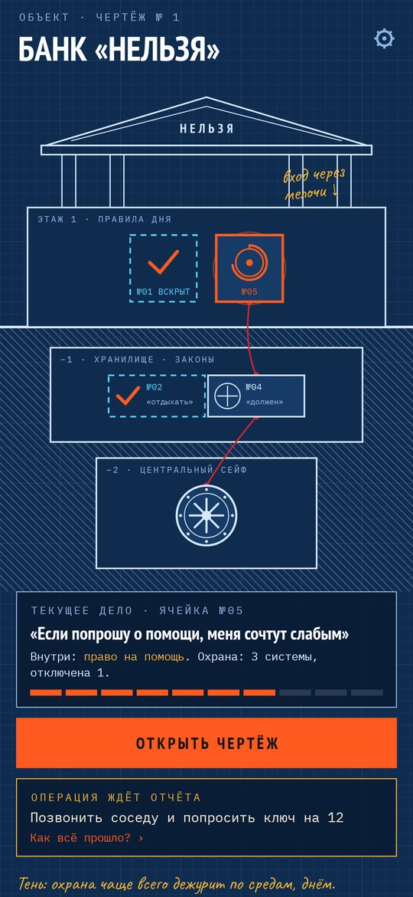
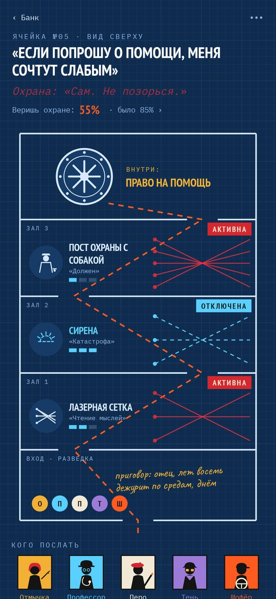
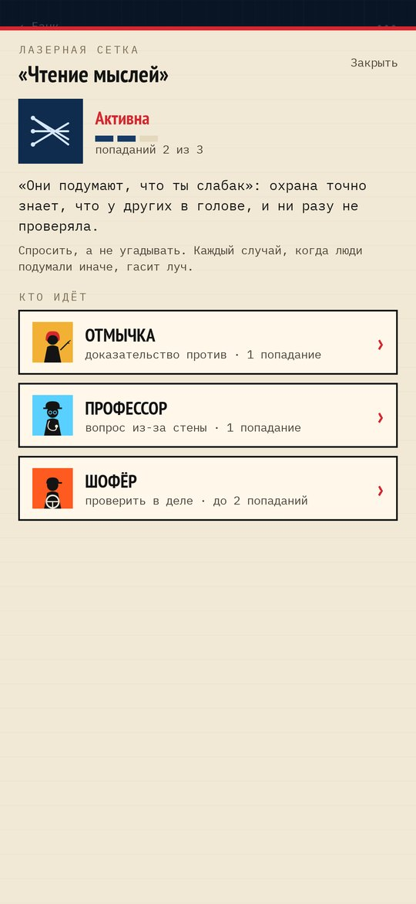
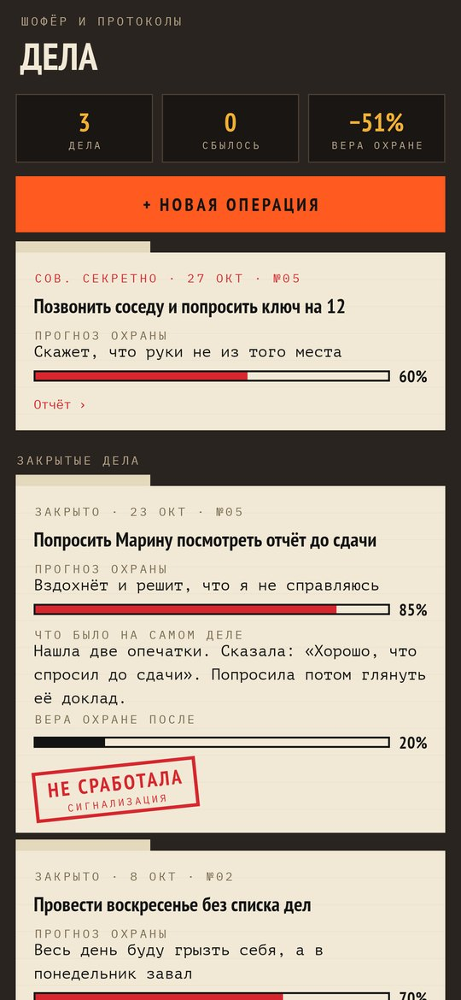
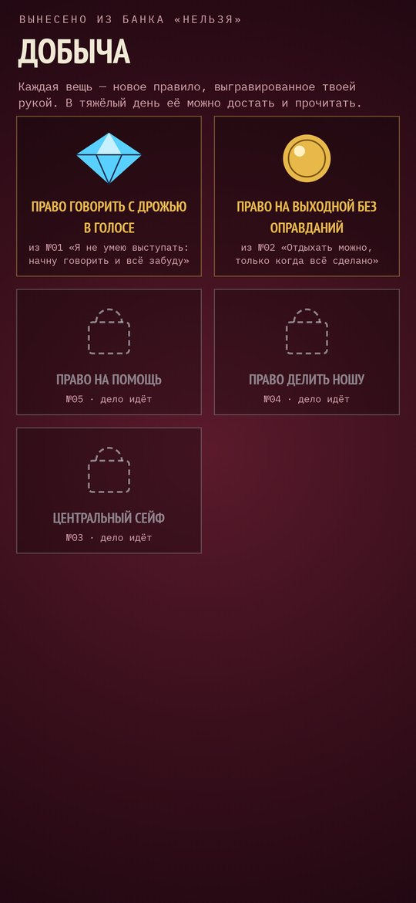

# Дело века

### Ограбление банка, где убеждения хранят то, что ты себе запретил

*Годами ты складывал в банк «Нельзя» всё, что себе запретил: просить о помощи, отдыхать, ошибаться, говорить «нет». Каждое убеждение — ячейка под охраной, а охрана говорит твоим голосом. Собери команду, проведи разведку, отключи охрану по одной системе и забери своё. Игра по мотивам когнитивно-поведенческой терапии. Бесплатно, без рекламы, аккаунта и интернета.*

[English](README.md) · **Русский** · [Изменения](CHANGELOG.md)

    

**[Скачать APK](https://github.com/bigdevwhale/insidejob/releases/latest/download/InsideJob.apk)** · Android 9+

---

## Как это устроено

1. **Банк в разрезе.** На первом этаже лежат правила дня («Если попрошу о помощи, меня сочтут слабым»), в хранилище — законы («Я должен со всем справляться сам»), в центральном сейфе — глубинные убеждения («Я недостаточно хорош»). Красная нить показывает, что на чём держится: вскроешь нижнюю ячейку, и наверху ослабнет сигнализация.
2. **У каждой ячейки есть охрана и добыча.** Охрана говорит своими словами, а внутри лежит право, которое убеждение отняло: на помощь, на отдых, на поздний старт. 192 готовые ячейки в восьми сферах или свои.
3. **Системы охраны — это уловки мышления.** Чтение мыслей — лазерная сетка, катастрофа — сирена, «должен» — пост охраны с собакой, «всё или ничего» — двоичный замок. Всего 14 систем, каждой нужно три попадания.
4. **Команда.** Отмычка подшивает доказательства против (1 попадание). Профессор стучит из-за стены вопросом, и честный ответ щёлкает механизмом (1 попадание, 304 вопроса). Шофёр везёт на операцию: охрана делает прогноз, ты идёшь и проверяешь, что будет на самом деле, а потом ставишь штамп (до 2 попаданий, 224 готовые операции). Тень записывает, когда дежурит охрана. Перо переписывает старый приговор и гравирует новое правило. Все растут от дела.
5. **Сначала разведка.** Кто и когда вынес приговор и хотя бы одна запись Тени: без этого сейф не открыть.
6. **Вскрытие.** Диск крутится, дверь открывается, добыча ложится в бархатную витрину с твоим новым правилом. Если охрана вернётся, ячейку запрут снова, но часть старой работы останется.
7. **Вечерний обход.** Одно тихое напоминание, только если за день ничего не записано. Если в тексте слова о беде, открывается страница с телефонами помощи.

Это не лечение и не замена психотерапевту.

## Лицензия

MIT. Шрифты: PT Sans Narrow, PT Mono, IBM Plex Mono и Caveat (SIL OFL).
